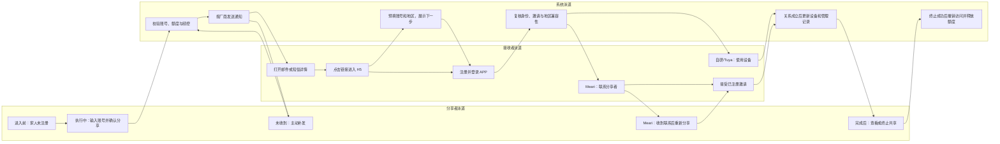
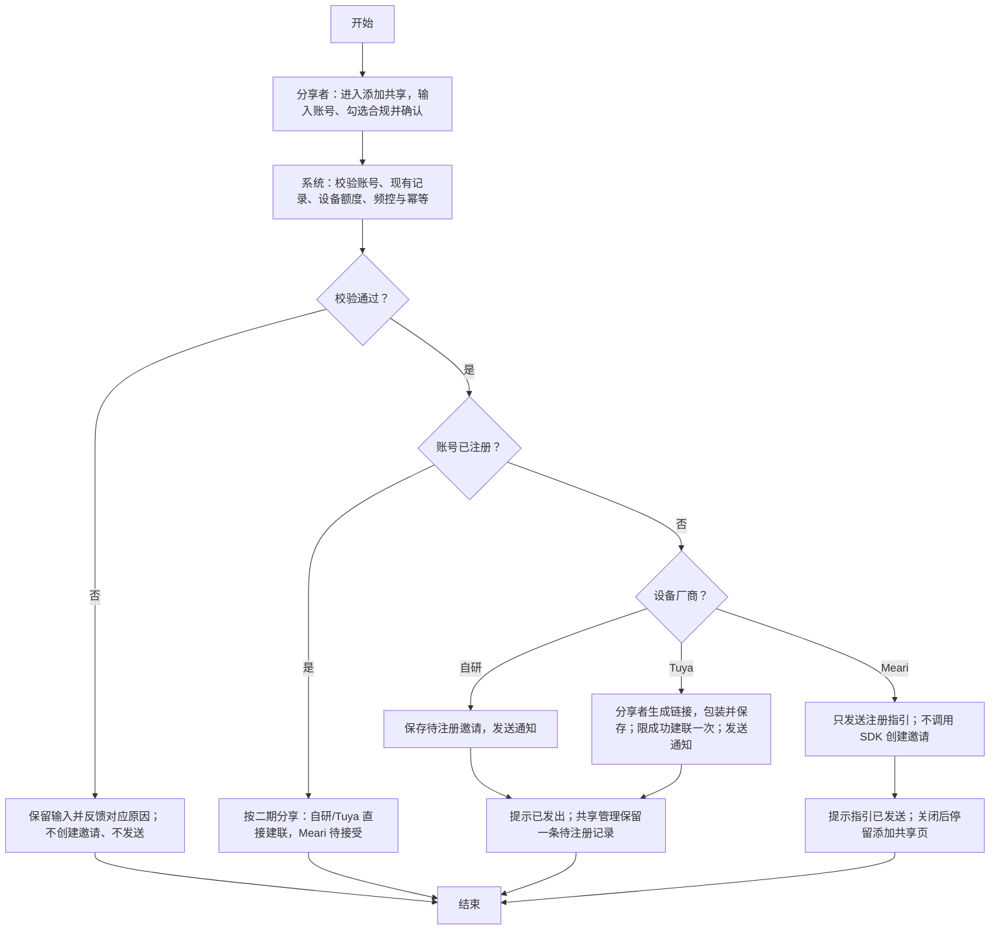
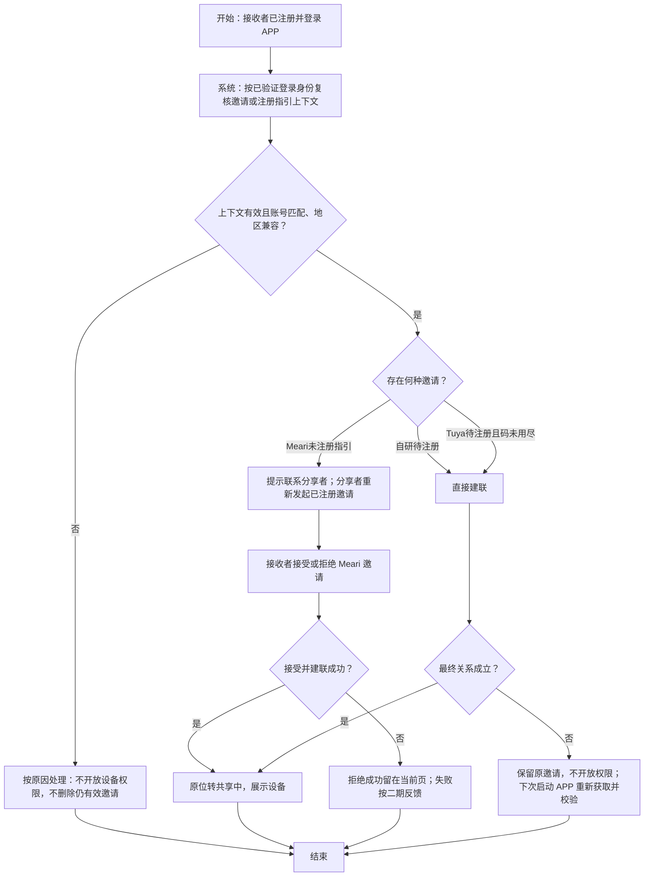
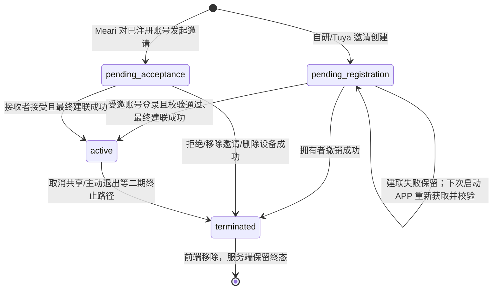

# 设备共享三期：未注册用户共享

| 项目 | 内容 |
| --- | --- |
| 更新日期 | 2026-10-13 |
| 交互原型 | [设备共享三期 · GitHub Pages](https://hawzz.github.io/root-interactivable-prototype/prototypes/device-sharing-phase-3/) |
| 相关文档 | [通知与注册模板](https://momcozy-in.feishu.cn/docx/VUCsdnhXGoNexBxH4WdcKWSVnZV)；[目标与成功口径](https://momcozy-in.feishu.cn/docx/L9n8dDfKbofvd7xVuPXcTnqknch)；[设备共享二期 PRD](https://momcozy-in.feishu.cn/docx/NWG1dRzmPofj9xx6rOOc00gunic)；[设备分享通知参考模板](https://momcozy-in.feishu.cn/wiki/Gw5YwnjlIigsw7kX2OXcaBTon0y) |

## 1. 摘要

家人尚未注册时，设备拥有者无法一次完成分享。三期支持自研、Tuya 先邀请，家人注册登录后直接获得共享设备；Meari 发送注册指引，注册后由拥有者重新分享，并提供通知补发及邀请管理。

## 2. 需求范围

| Feature | 本需求要做什么 | 用户可见结果 |
| --- | --- | --- |
| F01 发起未注册分享 | 复用添加共享入口，按账号地区固定输入类型，校验后按设备能力创建邀请或发送注册指引 | 自研/Tuya 出现待注册记录；Meari 提示注册指引已发送 |
| F02 通知与注册引导 | 定义三厂商邮件、短信和 H5，支持完整注册及下载/打开 APP | 接收者理解受邀账号、建议地区及注册后的下一步 |
| F03 注册后接收共享 | 自研/Tuya 在注册登录后校验邀请并直接建联，失败后于接收者下次启动 APP 重新获取；Meari 注册完成后联系拥有者重新分享 | 自研/Tuya 有效关系出现在设备列表；Meari 重新分享后进入接受/拒绝流程 |
| F04 通知补发 | 自研/Tuya 从待注册记录补发；Meari 在添加共享页重复提交同账号补发，统一执行冷却、次数及幂等控制 | 在允许条件下再次收到通知，原邀请与额度保持一致 |
| F05 共享记录管理 | 展示三种有效状态及单设备额度；按状态撤销邀请、移除邀请或取消共享 | 操作成功才移除记录并释放额度，失败保留原记录 |
| F06 接收入口一致性 | 清理自研/Tuya 接收侧历史确认弹窗及触发入口；启动、登录、前台恢复及通知入口按当前有效关系处理 | 自研/Tuya 直接接收共享，Meari 有效已注册邀请仍需接受/拒绝 |

## 3. 用户角色与 JTBD

| 场景 | 用户角色 | JTBD | 对应 Feature |
| --- | --- | --- | --- |
| S01 家人尚未注册，需要分享设备 | 设备拥有者 | 当家人尚未注册时，我想先发出可执行的邀请或注册指引，让对方知道如何继续接收设备 | F01、F02 |
| S02 从邮件或短信接收邀请 | 被邀请的家人/照护者 | 当收到分享通知时，我想知道使用哪个账号、选择哪个地区以及注册后做什么，从而接收正确设备 | F02、F03 |
| S03 对方未收到通知 | 设备拥有者 | 当对方未收到通知时，我想补发同一邀请或指引，从而继续触达对方而不增加共享记录 | F04 |
| S04 邀请发错或不再需要共享 | 设备拥有者 | 当邀请对象有误或照护关系结束时，我想终止相应邀请或共享，阻止后续接收和访问 | F05 |
| S05 再次登录或打开旧通知 | 被邀请的家人/照护者 | 当重新进入 APP 时，我想继续获取上次未成功接收的有效邀请，或按当前关系看到设备与待处理邀请，避免重复确认和无效授权 | F03、F06 |

## 4. 用户旅程

旅程说明：进入前，分享者的阻塞是家人尚未注册，统一入口将任务继续推进至通知触达。执行中，接收者通过完整通知和 H5 明确账号、地区及厂商对应的下一步；自研/Tuya 自动接收，Meari 需外部联系后重新分享。完成后，分享者从共享管理查看状态，按实际需要补发或终止；原邀请、通知历史和最终关系保持对应，避免重复记录。通知未收到、账号不匹配或邀请已撤销时，分别进入下述场景分支。

## 5. 核心流程与规则

### 5.1 S01：向尚未注册的家人发起分享

分享者的账号地区决定入口：中国只输入手机号并发送短信，海外只输入邮箱并发送邮件，页面不提供类型切换。同设备同账号已有待注册、待接受或共享中记录时阻止重复创建；待注册记录引导从共享管理补发。Meari 未注册同账号再次提交进入 S03 的指引补发流程。

自研/Tuya 创建的待注册记录无设备权限，占一条额度且不按时间自动到期；Tuya 包装链接保留同一码，成功建联次数固定为 1。Meari 只保存通知历史，不创建共享记录、不占额；分享结果需说明注册后联系分享者重新分享。发出邀请与发出指引都不能展示为设备已共享。

### 5.2 S02：接收通知、完成注册并进入 APP

接收者先打开邮件或短信详情，再点正文中唯一 H5 链接。打开通知本身只展示内容。H5 首屏明确分享者、设备、脱敏账号、建议地区和厂商对应的下一步，注册为主操作，下载/打开 APP 为并行路径。

| 流程触点 | 布局与格式 | 此处需要表达的内容和操作 |
| --- | --- | --- |
| 邮件收件箱/详情 | 列表展示 Momcozy、主题、摘要；详情白底居中单列，移动端左右留白至少 16px，段落左对齐，主按钮全宽、文字居中 | 分享者与设备 → 厂商邀请说明/注册指引 → 账号和地区建议 →「打开注册网页」→ 自动发送及帮助页脚；只放一个 H5 链接 |
| 短信会话 | 系统短信内一条连贯正文，不插入图片、二维码或第二个链接 | 【Momcozy】→ 分享者与设备 → 厂商后续动作 → 地区建议 → 唯一 H5 链接；点击正文链接进入 H5 |
| H5 首屏 | 居中单列，左右 16px 留白，小屏纵向滚动、桌面窄列 | 标识 → 标题/设备说明 → 提示区 → 脱敏账号/地区建议 →「立即注册」→ 下载标题/二维码/两类商店按钮 → APP 注册登录指引 |
| H5 注册 | 使用完整既有账号注册模块；字段顺序见 F02 | 预填账号和地区，验证码按账号类型发送；有效必填项及协议全部通过后才允许创建账号 |
| 注册完成 | 结果标题 → 结果说明 → 打开 APP 主按钮 → 二维码及商店按钮 | 自研/Tuya 提示登录 APP 后接收；Meari 提示联系分享者重新分享；邀请已失效时仍允许注册但不能通过原邀请接收设备 |

三厂商、两通知渠道及 H5 的完整文案、变量来源、布局和格式见 [通知与注册模板](https://momcozy-in.feishu.cn/docx/VUCsdnhXGoNexBxH4WdcKWSVnZV)，该附录是本试稿的模板定义。邮件/短信补发沿用同厂商同模板；模板语言沿用分享者 APP 语言，英文须逐项保持语义。地区文案统一为：“建议选择共享者的国家或地区「{owner_region}」注册并登录；如果选择其他国家/地区，可能无法查看共享设备及设备数据。”

点击注册后，推荐 Plan A 在当前 H5 会话复用完整注册模块；技术备选 Plan B 在同标签页跳转既有注册页，携带签名邀请上下文、预填信息及 `return_url`，完成后回到邀请完成页重新校验。A/B 是待评审的承载方案，不在用户界面提供切换；禁止 iframe、新窗口及丢失邀请上下文的普通外链。两方案使用同一字段及校验，返回时保留邀请来源，Plan A 还保留未提交表单。

修改账号或地区后提交需二次确认：继续注册不撤销原邀请；账号不同无法建立原共享关系，地区不兼容可能无法查看设备及数据。取消返回修改，继续则完成账号注册并复核邀请。国内 Android 固定中国、不展示地区选择。注册过程不锁定接收资格，邀请被撤销也不阻止普通注册。

账号匹配与地区兼容分开判断，国家代码不同不能直接判失败，美国与加拿大等同数据中心组合可建联。账号不匹配或地区不兼容时，APP 登录后不新增 Toast 或失效提示；仍有效邀请不撤销，可改用受邀账号及兼容地区登录后重新拉取。邀请撤销、Tuya 码用尽时不能新建关系，重复成功回执只同步原关系。

自研/Tuya 最终关系成立才展示设备；不增加处理中页面或接收方接受/拒绝操作。Tuya 仅最终建联成功消耗一次，注册、拉码及校验/执行失败不消耗次数。建联失败时保留原邀请及待注册记录、占额和未使用的 Tuya 码次数，不开放设备权限，不要求分享者重新发起；提示“暂时无法添加设备，请下次启动 APP 时重试。”被分享者下次启动 APP 时，系统重新获取原邀请，按已验证登录身份、受邀账号、数据中心兼容性、设备归属及邀请状态复核后再次尝试建联；Tuya 还须确认原码未用尽。仍失败则继续保留待注册状态；邀请已撤销、设备归属已变化或其他终态失效时不得恢复。接收方不新增手动重试按钮。

### 5.3 S03：对方未收到通知，分享者主动补发

分享者从自研/Tuya 待注册记录选择“重新发送通知”；Meari 从添加共享再次提交同一账号。后台先检查距离上次成功发送是否满 5 分钟，再核对生命周期次数与目标固定日配额，当日第 3 次实际发送前完成人机验证，通过后才发送。

| 此次补发步骤 | 判定与结果 |
| --- | --- |
| 确定原通知上下文 | 自研沿用原邀请，Tuya 沿用原码；Meari 按分享者、设备、规范化接收账号识别同一轮指引 |
| 校验发送间隔 | 未满 5 分钟不发送，提示“请等待 5 分钟后再发送” |
| 校验生命周期 | 首发加最多两次补发，最多 3 次实际通知；跨日不重置同一生命周期次数 |
| 校验固定日配额 | 按分享者账号＋设备＋规范化接收账号，每自然日最多 3 次；首发、补发及撤销重建合并计数；统一后台业务时区，未配置时 UTC+8 |
| 当日第 3 次发送 | 人机验证成功才继续；失败或取消不发送、不计数，可再次验证 |
| 渠道受理 | 邮件/短信服务受理成功计一次，明确发送失败不计；同一幂等键重试最多发送和计数一次 |
| 回到管理/发起页 | 补发不新增邀请、不增加额度、不生成 Tuya 新码或恢复码次数；Meari 仍无共享记录 |

生命周期用尽或固定日超限提示“操作过于频繁，请稍后再试”；验证失败提示“验证未通过，请重试”；发送失败提示“通知发送失败，请重试”。频控拦截不创建新邀请、不发送、不新增占额。重开 H5、切换地区或重新登录不触发补发。

撤销后向其他账号发起使用该账号的独立目标配额；向同账号重新发起获得新的邀请生命周期，但继承原目标的冷却、当日计数与通知历史。固定日切换只重置当日配额，Meari 同一轮指引生命周期也不重置。

### 5.4 S04/S05：终止共享或从历史入口恢复

分享者在记录菜单选择与当前状态对应的终止操作并二次确认。前端等待服务端和对应 SDK/关系服务最终成功，才移除记录及释放额度；明确失败、超时和未知错误码均保留原记录、额度与权限，可再次操作，不展示处理中或结果未知状态。

撤销待注册邀请后旧链接不能建立关系；移除待接受邀请后旧通知和 SDK 事件不能恢复接受；取消共享成功后接收者失去权限，缓存和迟到事件不能恢复访问。服务端保留通知历史和终态供校验。

接收者启动、登录、前台恢复或打开系统通知/消息中心时，自研/Tuya 直接按当前有效关系展示，不唤起接受/拒绝弹窗；旧通知本身不能创建关系。Meari 仅有效的已注册待接受邀请恢复确认弹窗。分享者提交前的确认、建联后通知、设备版本与权限校验继续执行。

## 6. 功能详情

### 6.1 F01：发起未注册分享

入口为既有共享管理的“添加共享”。合规勾选确认接收者为共同监护人或已授权照护者。单设备可见记录达到 20 条时禁用添加共享；服务端再次校验额度及重复记录。正常 APP 不显示厂商，厂商只影响后台分流和对应结果。

| 信息/字段 | 来源 | 使用与约束 |
| --- | --- | --- |
| 设备及拥有者 | 当前设备、已登录拥有者身份 | 校验设备归属与分享权限；归属变化不能沿用旧邀请 |
| 接收账号 | 分享者输入，按既有规则规范化 | 中国手机号、海外邮箱；格式有效且合规勾选后可提交；规范化值用于重复校验、通知及建联 |
| 合规确认 | 分享者勾选 | 未勾选不能提交 |
| 分享者 Nickname、设备名 | 发起时快照 | 通知与 H5 同一快照，不能写死示例人物或设备 |
| 分享者国家/地区、APP 语言 | 发起时账号与 APP 设置 | 地区建议与数据中心映射分别使用；通知和 H5 沿用语言 |
| 受邀账号注册状态、设备厂商 | 后台校验 | 选择已注册分享、待注册邀请或 Meari 注册指引 |

自研/Tuya 成功发起后保留一条待注册记录并说明邀请已发出；Meari 用单按钮强调弹窗说明注册指引邮件/短信已发送或重新发送，提醒注册后联系分享者，关闭后停留添加共享页。

### 6.2 F02：通知与完整注册

Tuya 分享码的单次成功建联限制由后台执行，不在邮件、短信、H5 或 APP 面向用户的文案中展示“仅接收一次”“一次性使用”等说明；不改变每码最多成功建联一次的业务规则。

| 注册字段/信息 | 必填性 | 行为与约束 |
| --- | --- | --- |
| 账号 | 必填 | 预填完整受邀账号，可修改；首屏脱敏；中国手机号/短信验证码，海外邮箱/邮箱验证码 |
| 验证码 | 必填 | 发送、倒计时、重发及有效期复用既有账号能力 |
| 密码 | 必填 | 提供显隐，强度与安全校验复用账号能力 |
| First Name | 必填 | 最长 50 字符 |
| Child’s Birthday/Due Date | 必填 | 日期范围复用既有账号能力 |
| 国家/地区 | 必填 | 默认分享者地区，可修改；国内 Android 固定中国且不展示选择器 |
| 隐私政策与服务条款 | 必选 | 正文及校验复用既有能力 |
| Newsletter | 可选 | 不影响创建账号 |
| 创建账号按钮 | 操作 | 仅既有能力判定全部必填项有效时可点击 |

邮件正文可展示完整邮箱，短信不重复完整手机号，H5 首屏脱敏，注册表单预填完整值。邀请 H5 与商店地址由技术配置；二维码和下载按钮只在 H5 展示。用户通知中不展示原始 Tuya 分享码。

### 6.3 F03/F06：建联、状态机与历史入口

| 可见状态 | 适用设备/对象 | 显示信息 | 权限 | 占额与菜单 |
| --- | --- | --- | --- | --- |
| 待注册 `pending_registration` | 自研/Tuya 未注册邀请 | 脱敏邮箱或手机号 | 无 | 1 条；重新发送通知、撤销邀请 |
| 待接受 `pending_acceptance` | Meari 已注册邀请 | Nickname＋脱敏账号 | 无 | 1 条；移除邀请 |
| 共享中 `active` | 全厂商有效共享 | Nickname＋脱敏账号 | 二期共享权限 | 1 条；取消共享 |

三种可见状态合计最多 20 条，状态转换原位更新。终止为服务端校验状态，不在管理页面显示终态或筛选项。自研/Tuya 待注册不按时间到期；Tuya 原码限成功建联一次，码失效不取消已建关系。Meari 已注册待接受持续有效，仅接受/拒绝、移除邀请或删除设备终止。Meari 未注册指引没有邀请状态。

建联后继承二期设备最低 APP 版本、设备列表、权限矩阵、主动退出、取消共享、网络异常、并发及旧通知失效规则；设备无“共享”标识、跳过 onboarding。关系只提供 ACL 与权限，实际控制依赖产品/面板已有本地蓝牙或云端能力。系统 Push 和消息中心沿用二期触发，建联不重复发送邀请邮件/短信；已注册手机号不新增短信。

### 6.4 F04：邀请、通知与频控的信息关系

| 信息对象 | 与其他信息的关系 | 保留与变化 |
| --- | --- | --- |
| 自研待注册邀请 | 关联拥有者、设备、规范化受邀账号、地区/语言快照及通知历史 | 补发沿用邀请，建联原位转共享中，撤销成功才移除前端记录 |
| Tuya 待注册邀请 | 同上，并关联一个云端保存的包装分享码上下文 | 注册及拉码不耗次，最终成功耗一次，重复成功回执保持同一关系 |
| Meari 注册指引轮次 | 按拥有者、设备、规范化接收账号关联一轮通知历史 | 没有共享邀请和管理记录；跨日不重置该轮生命周期计数 |
| 通知历史 | 每次渠道受理关联原邀请/指引轮次与目标固定日配额 | 撤销、跨日和重建不删除历史；明确失败不计实际发送 |
| 请求幂等信息 | 同一操作重试对应同一幂等键 | 不重复通知、不重复计数、不重复建联或占额 |
| 最终共享关系 | 关联设备及已验证接收身份，承载共享权限 | 仅关系成立开放权限；终止成功后旧链接及迟到事件不能恢复 |

以上为产品信息关系，字段接口、签名、并发原子处理与错误码由技术契约定义。

### 6.5 F05：按记录状态终止

| 当前状态 | 操作 | 成功结果 | 失败/超时/未知错误码 |
| --- | --- | --- | --- |
| 待注册 | 撤销邀请 | 移除记录、释放 1 条额度，旧邀请不可再建联 | 保留原记录与占额，可重试 |
| 待接受 | 移除邀请 | 移除记录、释放 1 条额度，旧通知/SDK 事件不可再接受 | 保留原记录与占额，可重试 |
| 共享中 | 取消共享 | 移除记录、释放 1 条额度并撤销接收者权限 | 保留原关系、占额和权限，可重试 |

每项均需二次确认，不能乐观删除；成功后可重新发起，重新发送仍经过账号、额度和频控检查。

## 7. 实施依赖与待确认事项

| 所在流程/Feature | 依赖或待确认项 | 需要明确的结果 |
| --- | --- | --- |
| 发起、建联 F01/F03 | 后台授权及接口契约 | 以已验证登录身份校验受邀对象、邀请状态、设备归属和权限；明确幂等、失败响应、迟到事件处理 |
| 历史入口 F06 | 存量后台记录迁移 | 历史已过期、已撤销等终态不复活；明确有效旧记录兼容方式，不凭移除弹窗跳过授权 |
| Tuya 建联 F03 | 真实 SDK、云端及撤销联调 | 包装、签名、防篡改、固定一次成功、原子扣次、已用尽查询与撤销后失效；平台校验后交付码 |
| H5 注册 F02 | A/B 承载方式待评审 | 优先验证 A；B 明确签名上下文、回跳、浏览器返回及安装后恢复 |
| 下载与进入 APP F02 | 商店地址、二维码、App Link | 冻结生产地址与安装后上下文恢复方案 |
| 补发 F04 | 渠道、人机验证及后台频控 | 落地渠道受理计数、原子校验、幂等、第 3 次验证及异常降级 |
| 设备访问 F03 | 产品/面板控制能力 | 逐产品验证实际控制能力，不以关系成立直接推定设备可控 |

长期待注册会占额，可由拥有者撤销；账号接管、手机号回收、旧链接信息披露及多分享者共同骚扰仍有残余风险。控制措施贯穿前述身份校验、脱敏展示和发送频控。当前资料中的原型验证使用模拟云端/SDK，生产 APP、通知、账号、H5 与真实设备联调尚未执行。

## 8. 验收索引

| ID | 验收主题 | 结果要求 | 原型页面 |
| --- | --- | --- | --- |
| P3-AC-01 | 统一入口与能力分流 | 正常 APP 不显示厂商；自研/Tuya 进入待注册；Meari 仅发送注册指引 | 页面流转图、添加共享 |
| P3-AC-02 | 状态、额度与管理操作 | 仅三种可见状态合计 20 条；待注册提供补发与撤销，待接受提供移除，共享中提供取消；补发不新增记录或占额；Meari 注册指引无记录、不占额 | 共享管理 |
| P3-AC-03 | 未注册提交 | 格式与合规有效才可提交；继承二期中国仅手机号、海外仅邮箱的强制规则，不提供切换；自研/Tuya 重复待注册阻止建单并引导从管理页补发；Meari 同账号再次提交按补发规则处理 | 添加共享、Meari 能力边界 |
| P3-AC-04 | 三套邮件 | 逐厂商核对 附录第 1/2 节 的主题、首句、邀请说明或注册指引、账号、地区、唯一 H5 按钮及页脚顺序；海外未注册邮箱首次发送及每次成功补发各产生一封；收件箱 → 详情 → 正文链接 → 对应 H5，打开邮件不直接进入 APP | 邮件收件箱与详情 |
| P3-AC-05 | 三套短信 | 逐厂商核对 附录第 1/3 节 的单条正文顺序和唯一 H5 链接；中国未注册手机号首次发送及每次成功补发各产生一条；自研不展示时间到期并提示使用受邀账号注册登录，Tuya 不展示时间到期并提示使用受邀账号注册登录，Meari 不展示邀请有效期；短信列表 → 会话/详情 → 正文链接 → 对应 H5 | 短信列表与会话 |
| P3-AC-06 | 三套 H5 完整注册与下载 | 逐厂商核对 附录第 1/4 节 的首屏模块顺序、标题、提示区及注册完成/邀请失效文案；中国短信预填手机号/短信验证码，海外邮件预填邮箱/邮箱验证码；A/B 共用完整注册；自研/Tuya 在原邀请未撤销且 Tuya 码未用尽时，按受邀账号及兼容数据中心直接建联，Meari 注册后须外部联系 `{nickname}` 二次分享；修改信息不撤销原邀请，国内 Android 固定中国 | 注册与下载 H5 |
| P3-AC-07 | 账号与数据中心恢复 | 账号不匹配无法建联，跨数据中心时可能看不到设备；原邀请保持有效。自研可在邀请未撤销时、Tuya 可在邀请未撤销且码未用尽时改用受邀账号及兼容地区恢复；同数据中心的美国/加拿大不因国家不同而阻断；历史过期终态、已撤销邀请或 Tuya 已用尽分享码不可新建关系 | 登录后的设备结果 |
| P3-AC-08 | 成功、失败与建联后继承 | 自研/Tuya 无 processing 自动建联；建联失败保留原邀请、待注册记录及占额，Tuya 不耗次；被分享者下次启动 APP 自动重新获取、复核并尝试建联，不要求分享者重新发起、不新增手动重试入口；成功进入 active 后继承二期版本、展示、权限、通知、取消/退出、网络与并发规则及蓝牙方案 A；关系只提供 ACL 与权限，实际控制依赖产品/面板已有能力；Meari 恢复二期确认 | 登录后的设备结果 |
| P3-AC-09 | 撤销、移除、取消与历史终态 | 三种终止操作仅成功/失败；成功才删除记录、释放额度并使旧分享邀请不能再建立共享关系，失败保留原状态；自研待注册不按时间自动过期、持续占额，撤销成功才释放且不清除通知历史；Tuya 待注册无时间到期、持续占额，成功建联 1 次后码失效但关系保留，撤销才删除释放；Meari 待接受持续有效，不因时间自动过期 | 撤销与历史终态 |
| P3-AC-10 | Meari 边界 | 未注册不创建共享邀请；首次发送及补发成功使用强调弹窗；注册后联系 `{nickname}`，由分享者按二期重新发起 | Meari 能力边界 |
| P3-AC-11 | 补发、防骚扰与幂等 | 5 分钟冷却、单邀请生命周期最多 3 次；同一分享者+设备+账号固定日最多 3 次，第 3 次先机器验证；失败不计、幂等重试不重复 | 共享管理、添加共享、评审时间控制 |
| P3-AC-12 | 非 Meari 历史邀请弹窗移除 | 自研/Tuya 已注册分享及未注册后恢复建联均无接收方接受/拒绝确认；启动、登录、前台恢复、历史系统通知及消息中心入口不再唤起旧邀请确认弹窗，只按有效关系展示结果；保留分享者确认、通知、权限与版本校验；Meari 已注册待接受仍须确认；历史终态不复活 | 登录后的设备结果、页面流转图 |

## 9. 测试用例

| 用例名称 | 前置条件 | 输入 | 操作 | 预期结果 |
| --- | --- | --- | --- | --- |
| 自研未注册邮箱（P3-AC-03/04/06） | 海外分享者，设备支持共享，19 条及以下占额 | 合法未注册邮箱 | 输入合法未注册邮箱并确认 | 创建待注册；发送一封自研模板邮件；占 1 条；无设备权限，详情链接进入自研 H5 |
| Tuya 未注册手机号（P3-AC-03/05/06） | 中国分享者，链接生成成功 | 合法未注册手机号 | 输入合法未注册手机号并确认 | 包装链接保存云端；发送一条 Tuya 模板短信；详情链接进入 Tuya H5，不暴露原始 Tuya URL |
| Meari 未注册邮箱（P3-AC-01/03/04/10） | 海外分享者，Meari 设备 | 合法未注册邮箱 | 提交合法未注册邮箱 | 单按钮强调弹窗提示注册指引邮件已发送；发送一封 Meari 模板邮件并指向对应 H5；零邀请、零管理记录、零占额、设备未共享 |
| Meari 未注册手机号（P3-AC-01/03/05/10） | 中国分享者，Meari 设备 | 合法未注册手机号 | 提交合法未注册手机号 | 单按钮强调弹窗提示注册指引短信已发送；发送一条 Meari 模板短信并指向对应 H5；零邀请、零管理记录、零占额、设备未共享 |
| 强制账号类型（P3-AC-03） | 分别使用中国与海外分享者账号 | 中国/海外分享者账号 | 进入添加共享 | 中国只展示手机号输入，海外只展示邮箱输入；均无账号类型切换入口，错误类型无法提交 |
| 邮件打开（P3-AC-04/06/07） | 三厂商分别已发送海外未注册邮箱通知 | 三厂商邮箱通知及正文 H5 链接 | 打开收件箱、进入邮件详情并点击正文链接 | 列表和详情不直接打开 APP；正文链接进入对应厂商 H5，自研不展示时间到期并提示使用受邀账号注册登录，Tuya 不展示时间到期并提示使用受邀账号注册登录，Meari 不展示邀请有效期并提示联系 `{nickname}` |
| 短信打开（P3-AC-05/06） | 三厂商分别已发送中国未注册手机号通知 | 三厂商短信通知及正文 H5 链接 | 打开短信列表、进入 Momcozy 会话并点击正文链接 | 列表和详情不直接打开 APP；正文链接进入对应厂商 H5，自研不展示时间到期并提示使用受邀账号注册登录，Tuya 不展示时间到期并提示使用受邀账号注册登录，Meari 不声称已共享并提示联系 `{nickname}` |
| H5 默认注册（P3-AC-06） | 邀请携带账号、地区、分享者语言 | 受邀账号、地区、分享者语言 | 从邮件/短信详情进入 H5 | 首屏预填邀请账号和地区，使用分享者 APP 语言，同时展示注册主操作、二维码及两类应用商店按钮 |
| Plan A 完整注册（P3-AC-06） | H5 使用推荐的同页复用方案 | 预填账号、验证码、密码、姓名、孩子日期、地区、协议 | 点击注册，发送验证码并填写密码、First Name、孩子日期、地区和协议 | 全程处于同一 H5 会话；邮箱使用邮箱验证码、手机号使用短信验证码；Newsletter 不影响提交；返回首屏后邀请与表单状态可恢复 |
| Plan B 完整注册（P3-AC-06） | H5 使用同标签页跳转方案 | 同一组注册字段及签名邀请上下文 | 点击注册进入账号站点，完成同一套注册字段后回跳 | 不打开新窗口或 iframe；预填账号、地区和语言；完成后通过回跳地址返回并重新校验邀请 |
| H5 修改账号/地区（P3-AC-06/07） | H5 已加载原邀请上下文 | 不同账号或地区 | 修改账号或地区并提交注册 | 弹出影响确认；明确继续注册不撤销原邀请。账号不匹配无法命中邀请，跨数据中心时可能看不到设备；原邀请未撤销时仍可由受邀账号及兼容地区恢复 |
| 注册中邀请撤销或失效（P3-AC-06/07/09） | 已进入注册表单，原邀请被拥有者撤销或设备已删除 | 已撤销/设备已删除的邀请上下文、有效注册资料 | 继续填写并创建账号 | 不打断普通注册；提示邀请已失效，完成后不建联，联系 `{nickname}` 重新分享；不把失效描述为时间过期 |
| 国内 Android H5（P3-AC-06） | 分享者为中国区，终端为国内 Android 模板 | 中国区邀请上下文、国内 Android 终端 | 进入 H5 | 地区固定中国且不展示地区选择；二维码与应用商店入口仍可见 |
| 分享者区域提示（P3-AC-03/04/07/10） | 分享者为中国区，目标账号未注册 | 未注册账号、分享者中国地区 | 完成自研/Tuya 或 Meari 未注册提交 | 自研/Tuya 提示分享已发送并建议对方优先使用相同国家/地区，说明跨数据中心可能不可见；Meari 注册指引使用相同风险提示并要求注册后重新发起 |
| 账号不匹配（P3-AC-06/07） | 自研/Tuya 邀请仍有效 | 非受邀账号 | 注册或登录为非受邀账号 | 不建立关系；原邀请不撤销、不删除、保持原邀请，改用受邀账号后仍可在原邀请未撤销时恢复 |
| 跨数据中心 · 自研（P3-AC-07） | 邀请要求中国数据中心，原邀请未撤销 | 受邀账号、德国地区 | 以德国等其他数据中心地区登录受邀账号 | 可能看不到共享设备及数据；邀请保留且不补发，改用兼容地区登录后可在原邀请未撤销时恢复 |
| 跨数据中心 · Tuya（P3-AC-07） | 邀请要求中国数据中心，未撤销且码未用尽 | 受邀账号、德国及兼容地区、超过 1 小时时间点 | 以德国等其他数据中心地区登录，超过 1 小时后切回兼容地区 | 时间经过不使 Tuya 到期；可建联且耗次为 1，失败的账号/地区校验不耗次 |
| 同数据中心跨国家（P3-AC-07/08） | 分享者账号为美国，受邀账号及邀请仍有效 | 美国分享者、加拿大接收者 | 被邀请者选择加拿大注册登录 | 美国与加拿大映射至同一数据中心时可自动拉取并展示设备，不因国家代码不同而阻断 |
| 兼容地区恢复 · 自研/Tuya（P3-AC-07/08） | 对应厂商邀请未撤销且 Tuya 码未用尽，受邀账号 | 受邀账号、兼容地区、有效邀请 | 改用与设备数据中心兼容的地区登录 | 自动拉取关系或分享码并近实时建联；无接受/拒绝和 processing |
| Meari 注册后未重新分享（P3-AC-07/10） | 已收到 Meari 注册指引并完成注册登录 | Meari 注册指引与已注册账号 | 打开 APP | 不自动建联、不弹窗；被分享人需从外部链路联系拥有者 |
| 拥有者重新发起 · Meari（P3-AC-07/08/10） | 对方已注册，拥有者按二期重新分享并创建有效待接受邀请 | Meari 已注册接收账号、接受/拒绝选择 | 被分享人使用受邀账号并在兼容数据中心登录 | 弹出二期接受/拒绝弹窗；接受后显示设备，拒绝后停留当前列表 |
| 建联失败（P3-AC-08） | 自研/Tuya 云端或 SDK 返回失败 | 有效邀请、模拟建联失败结果 | 登录后执行建联 | 提示下次启动 APP 重试；保留原邀请、待注册记录及占额，不开放权限、Tuya 不耗次；不要求拥有者重新分享，无手动重试入口 |
| 20 条额度（P3-AC-02） | 待注册、待接受、共享中合计 20 条 | 新受邀账号 | 发起新邀请 | 提交被阻断，不创建记录或通知 |
| 自研持续有效（P3-AC-06/08/09） | 自研待注册，原邀请未撤销 | 受邀账号、兼容地区、1 小时/跨日/30 天及重复回执 | 推进 1 小时、跨日及 30 天后按受邀账号及兼容地区登录，再重复处理成功回执 | 记录不自动删除且占 1 条；成功原位转共享中，重复回执不新增关系、不重复占额 |
| Tuya 永久有效与单次使用（P3-AC-06/08/09） | Tuya 待注册，原邀请未撤销 | 受邀账号、兼容地区、1 小时/30 天及重复回执 | 推进 1 小时/30 天后按受邀账号登录建联，再重复处理成功回执 | 待注册不自动删除且占 1 条；首次成功后码耗尽、转共享中，重复回执不新增关系、不重复扣次；码失效不取消已有关系 |
| Tuya 账号校验不耗次（P3-AC-07/08） | 分享码剩余 1 次，原邀请未撤销 | 错误及正确账号/地区 | 使用非受邀账号或不兼容数据中心注册登录，然后改用正确账号/地区 | 失败校验不耗次、不删记录；正确账号最终建联成功才耗 1 次 |
| Tuya 旧码不得复活（P3-AC-08/09） | 已撤销邀请，或共享中关系已被取消 | 已撤销或关系已取消的旧链接/码 | 打开旧 H5 并尝试通过旧码建联 | 不新建关系、不恢复权限；新邀请由拥有者重新发起并生成新码，仍受原通知历史约束 |
| Meari 待接受持续有效（P3-AC-09/10） | 已注册 Meari 待接受跨过 1 小时后重新登录或回到前台 | 有效 Meari 已注册待接受邀请 | 恢复待处理邀请 | 弹窗仍可恢复；待接受记录不因时间自动过期，仅可由接受、拒绝或移除终止 |
| 建联后继承二期规则（P3-AC-07/08） | 自研/Tuya 待注册邀请有效且账号、地区正确；准备不同控制能力的产品/面板 | 受邀账号、兼容地区及不同控制能力产品 | 注册登录并完成建联后检查版本、设备列表、权限、控制、取消和主动退出 | active 关系按二期规则及蓝牙方案 A 执行；设备无共享标识并跳过 onboarding；关系只提供 ACL 与权限，实际控制按产品/面板已有的本地蓝牙或云端能力验收；已注册手机号不发送短信；邀请邮件/短信不重复发送 |
| 自研/Tuya 无接收方确认（P3-AC-08/12） | 分别准备自研/Tuya 已注册账号分享及未注册待注册邀请 | 自研/Tuya 已注册和待注册两组账号 | 发起已注册分享，或使用受邀账号注册登录后恢复建联 | 既有校验及最终建联成功后直接进入共享中，不出现接收方接受/拒绝弹窗；分享者提交前的确认弹窗仍保留 |
| 历史通知与登录恢复（P3-AC-07/09/12） | 自研/Tuya 存在历史通知或旧邀请入口，分别准备有效关系与已终止邀请 | 历史通知/入口、有效关系和终止邀请 | 启动、登录、回到前台或从系统通知/消息中心进入 | 不弹出历史接受/拒绝确认；有效关系按现有权限及版本显示，历史终态不复活；无有效关系时不开放设备权限 |
| Meari 确认流程保留（P3-AC-10/12） | 已注册账号有有效 Meari 待接受邀请 | 有效 Meari 待接受邀请、接受/拒绝选择 | 登录或从通知恢复，分别选择接受和拒绝 | 仍展示接受/拒绝弹窗；接受并建联成功后进入设备页，拒绝成功后留在当前页；未注册指引不触发该弹窗 |
| 重复邀请（P3-AC-02/03） | 同设备同账号已有待注册 | 原待注册受邀账号 | 再次从添加共享提交 | 不新增、保持原邀请，提示从共享管理的原记录补发 |
| 待注册邮件补发（P3-AC-02/04/11） | 自研或 Tuya 待注册，首次发送已受理 | 未满/已满 5 分钟的补发请求 | 未满 5 分钟补发；推进至 5 分钟后再次补发 | 首次提示等待；满足间隔后发送对应模板邮件，原记录仍占 1 条；自研邀请保持持续有效，Tuya 无时间到期且原码次数不变 |
| 待注册短信补发上限（P3-AC-05/11） | 待注册手机号邀请 | 三次补发请求，各间隔至少 5 分钟 | 每隔至少 5 分钟连续补发 3 次 | 前 2 次成功，第 3 次统一频控提示；合计最多 3 条短信 |
| Meari 同账号补发（P3-AC-03/10/11） | 已发送一次 Meari 注册指引，无管理记录 | 原 Meari 未注册账号、间隔 5 分钟 | 5 分钟后在添加共享重新提交同一账号 | 提示注册指引已重新发送；仍零邀请、零管理记录、零占额、设备未共享 |
| 固定日目标 3 次（P3-AC-11） | 同一分享者、设备、接收账号当日已有 2 次实际通知 | 第 3/4 次请求、验证成功/失败/取消、次日时间点 | 发起第 3 次并完成机器验证，再尝试第 4 次；随后进入下一固定日 | 第 3 次验证通过后发送；验证失败/取消不发送不计数；第 4 次被拦截；次日目标日配额重置 |
| 发送失败与幂等（P3-AC-11） | 渠道失败或客户端超时重试 | 渠道失败结果、相同幂等键 | 先模拟失败，再以同一幂等键重试 | 失败不计次数；同一幂等键最多实际发送并计数一次 |
| 撤销后改错账号（P3-AC-09/11） | 待注册邀请已向错误账号发送 | 新的不同接收账号 | 撤销后立即向不同账号发起 | 允许创建新邀请；不同账号独立统计目标日配额 |
| 撤销后同账号重发（P3-AC-09/11） | 原待注册邀请已撤销 | 原接收账号 | 立即对同账号重新发起 | 新邀请获得新的生命周期次数，但不能绕过 5 分钟冷却和同目标当日 3 次上限 |
| 待注册撤销（P3-AC-02/09） | 自研/Tuya 待注册 | 待注册记录、成功/失败/超时/未知结果 | 确认撤销，分别模拟成功与失败/超时/未知错误码 | 成功后删除记录、释放额度且旧分享邀请不能再建立共享关系；失败保留记录可重试 |
| 待接受移除（P3-AC-02/09） | Meari 待接受 | 待接受记录、成功/失败/超时/未知结果 | 确认移除，分别模拟成功与失败/超时/未知错误码 | 成功后删除记录、释放额度且旧通知/SDK 事件不可接受；失败保留记录可重试 |
| 共享中取消（P3-AC-02/08/09） | 任一厂商共享中 | 共享中记录、成功/失败/超时/未知结果 | 确认取消，分别模拟成功与失败/超时/未知错误码 | 成功后删除记录、释放额度并撤销接收者权限；失败保留关系、额度与权限可重试 |
| 建联失败后下次启动恢复（P3-AC-07/08/09） | 自研/Tuya 上次建联失败，原邀请有效且待注册；Tuya 原码未用尽 | 已验证受邀账号、兼容地区、下次建联成功结果 | 被分享者退出后再次启动 APP | 系统重新获取原邀请并复核；成功原位转共享中、占额仍为 1，Tuya 仅本次成功耗 1 次；不创建新邀请、不补发通知、不要求分享者操作 |
| 建联失败后邀请撤销（P3-AC-07/08/09） | 上次建联失败后拥有者已撤销原邀请 | 已撤销邀请及已验证受邀账号 | 被分享者下次启动 APP | 系统复核终态后不建联、不开放权限、不恢复记录，不消耗 Tuya 码次数，不因旧缓存或迟到事件恢复邀请 |
