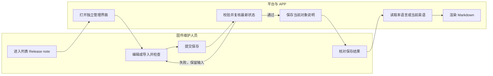

# 固件支持 Release note 及多语言配置

| 项目 | 内容 |
| --- | --- |
| 更新日期 | 2026-11-06 |
| 交互原型 | [GitHub Pages 原型](https://hawzz.github.io/root-interactivable-prototype/prototypes/firmware-release-note/) |
| 相关文档 | [V6 共识](https://github.com/HawZZ/root-interactivable-prototype/blob/main/prototypes/firmware-release-note/docs/consensus-v6.md)、[多语言导入说明](https://github.com/HawZZ/root-interactivable-prototype/blob/main/prototypes/firmware-release-note/docs/import-spec.md)、[补充验收规格](https://github.com/HawZZ/root-interactivable-prototype/blob/main/prototypes/firmware-release-note/docs/review-contract.md)、[UI 现状与边界](https://github.com/HawZZ/root-interactivable-prototype/blob/main/prototypes/firmware-release-note/docs/ui-baseline.md)、[测试用例附录](https://github.com/HawZZ/root-interactivable-prototype/blob/main/prototypes/firmware-release-note/docs/test-cases.md) |

## 1. 摘要

为 MCU/模组固件及虚拟版本补充独立 16 语言 Release note：发布完成前可维护，英语兜底，支持 Excel/CSV 导入与 APP Markdown 读取，并初始化存量、阻断关联删除。

## 2. 需求范围

| Feature | 本需求要做什么 | 用户可见结果 |
| --- | --- | --- |
| F01 创建与编辑 | 三类对象分别维护独立 Release note，并按对象状态控制编辑 | 说明互不拼接、替换或联动 |
| F02 多语言配置与兜底 | 支持 16 种语言；英语默认、必填并兜底，其余非必填 | 缺译时读取当前对象的英语 |
| F03 多语言导入 | 通过 Excel/CSV 导入当前对象的多语言 Markdown | 预检后应用独立管理表单，保存说明后生效 |
| F04 存量初始化 | 为历史三类对象补充字段并初始化英语 `Bug fixed` | 其他语言未配置；重复初始化不覆盖维护内容 |
| F05 APP 调用与 Markdown | 平台编辑、预览；APP 按对象和语言读取并渲染 | 虚拟版本读取自身说明，可用于 APP 升级说明 |
| F06 关联删除限制 | 沿用虚拟版本与固件的现有关联关系校验删除 | 有任一关联时阻止直接删除并保留原数据 |

入口位于 `产品详情 > 固件配置 > 固件版本 / 虚拟版本列表 > 操作 > Release note`，打开独立管理界面。原新建、编辑及详情信息抽屉保留既有用途；对象创建成功自动初始化英语 `Bug fixed`，随后可从列表单独维护。备注、发布日志、包信息、组件及发布配置不能替代该字段。APP 仅要求读取及 Markdown 验证能力，不扩展升级页面；页面形态和新增边界见[UI 基线](https://github.com/HawZZ/root-interactivable-prototype/blob/main/prototypes/firmware-release-note/docs/ui-baseline.md)。

## 3. 用户角色与 JTBD

| 场景 | 用户角色 | JTBD | 对应 Feature |
| --- | --- | --- | --- |
| S01 维护发布说明 | 固件维护人员 | 当创建、测试或发布固件时，我想维护对应语言说明，从而让用户了解版本变化 | F01、F02、F05 |
| S02 批量填写语言 | 固件维护人员 | 当多语言文案已准备好时，我想安全导入当前对象，从而减少录入并避免误覆盖 | F02、F03 |
| S03 读取版本说明 | APP 用户 | 当 APP 展示目标对象时，我想看到当前语言或英语兜底内容，从而正常理解更新 | F02、F05 |
| S04 管理存量与删除 | 固件维护人员 | 当处理历史对象或被引用固件时，我想获得默认说明并避免破坏关联，从而安全维护 | F04、F06 |

## 4. 用户旅程

维护人员在既有信息表单完成创建，系统自动生成英语默认值；随后从固件或虚拟版本列表操作列进入独立 Release note 管理，编辑、预览或导入后单独保存。平台在说明保存前复核对象最新状态，历史初始化同样提供英语默认值。导入失败不应用任何语言；保存失败或状态拒绝时保留未提交内容，修正后可重试；从未已发布的暂停对象恢复发布中后可重试，首次已发布永久锁定，不能恢复编辑。

## 5. 核心流程与规则

### 5.1 S01：创建、编辑与发布截止

创建成功自动初始化默认说明；开发中、测试中和发布中可从独立入口编辑及导入；暂停发布、已停止和已发布只读。定时发布生效前仍可维护，生效后按实际状态判断；自动发布达到 100% 或全面发布生效后永久截止。首次已发布后不能通过修改其他配置重新打开编辑；从未已发布的暂停对象恢复到发布中后可再次编辑。保存时以最新状态和英语有效性复核，越过截止点则拒绝并保留输入。

保存仅更新当前对象说明，不改变固件包、组件集合、应用对象、发布方式、范围、进度、对象状态、备注或发布日志。保存失败保留输入；取消编辑不改变已保存记录。

### 5.2 S02：Excel/CSV 导入

流程：列表「Release note」 → 独立管理 → 选择文件 → **预检** → 差异确认 → **应用当前表单** → **保存 Release note**。本节的“当前表单”和“主保存”均指 Release note 独立管理表单及其保存操作。预检失败、无有效变更或状态已只读时禁止应用，已保存数据零改写。

导入只作用当前对象。Excel 使用 16 语言数据格全空的模板，CSV 使用 UTF-8；非空值覆盖当前表单对应语言，空值、纯空白或缺列保留现值，包括自定义英语和非英语译文。导入不承担清空语义；仅在表单手工清空非英语后才恢复英语兜底，合并后英语仍须非空。空文件、只有表头或无有效变更禁止应用。

预检后应用只写入当前表单，主保存才持久化。取消导入不改原表单；解析错误或超限整单拒绝；应用后取消编辑、状态拒绝或保存失败均不部分更新已保存记录，失败时保留当前草稿。文件或对象变化后重新预检。完整模板、格式、工作表/数据行、编码、重复列、公式及异常定位规则见[导入说明](https://github.com/HawZZ/root-interactivable-prototype/blob/main/prototypes/firmware-release-note/docs/import-spec.md)，L/L+1 和实施冻结项见[补充验收规格](https://github.com/HawZZ/root-interactivable-prototype/blob/main/prototypes/firmware-release-note/docs/review-contract.md)。

### 5.3 S03：语言兜底与 Markdown

三类对象分别维护 16 种语言。英语 `en` 默认精确为 `Bug fixed`，必填且兜底；其余 15 种为 `zh、de、fr、zh-Hant、it、pt、es、ar、vi、id、th、ms、ja、ru、fil`，非必填。目标语言有内容时读取自身，否则读取当前对象的当前英语；非英语手工清空后恢复兜底，英语修改后缺译内容随新英语读取。切换语言保留草稿，缺译展示不得伪装成独立译文。

平台提供 Markdown 源码编辑和只读预览，APP 读取已保存内容并渲染。标题、列表、强调、链接和换行为必需能力；表格、代码块和图片按技术冻结的共同能力支持或可读降级。保存与导入须保留源码、换行和转义；平台预览与 APP 使用同一源码和策略，按 MD01–MD10 核对语义、内容、结构及安全一致，允许视觉差异。原始 HTML/脚本不得执行，危险链接/图片协议不得运行；共同元素及 URL 策略在实施验收前由技术冻结，详见[补充验收规格](https://github.com/HawZZ/root-interactivable-prototype/blob/main/prototypes/firmware-release-note/docs/review-contract.md)。

### 5.4 S04：存量初始化与关联删除

Release note 为新增字段，无旧译文迁移。上线时为全部存量 MCU、模组和虚拟版本初始化英语 `Bug fixed`，覆盖各状态；其他语言未配置，只读状态不开放人工编辑。重复初始化不得覆盖已维护内容。

存在任一现有虚拟版本关联时阻止直接删除固件，开发中也不能绕过；失败后固件、说明及全部关联保持原值，不自动解绑或级联删除。无关联时仍按既有生命周期判断。

## 6. 功能详情

### 6.1 F01：对象范围与状态窗口

三类对象分别绑定自己的说明，均从列表操作列的 Release note 入口单独管理。独立界面仅展示对象只读上下文和说明配置；发布日志和内部备注保持原用途，不作为来源或默认值。

| 状态或阶段 | 操作 | 结果与恢复 |
| --- | --- | --- |
| 创建成功 | 自动初始化英语默认值 | 创建后回到列表，从 Release note 入口独立编辑、预览及导入 |
| 开发中 | 编辑、预览、导入 | 保存不改变对象状态及其他配置 |
| 测试中 | 编辑、预览、导入 | 定时发布生效前可保存，之后按最新状态判断 |
| 发布中 | 编辑、预览、导入 | 达到 100% 或全面发布生效后关闭 |
| 暂停发布 | 只读 | 从未已发布且恢复发布中后可编辑；首次已发布后永锁 |
| 已停止 | 只读 | 保留历史说明，不重开编辑 |
| 已发布 | 只读 | 首次已发布即永久截止 |

各对象按自身状态判断；保存时复核最新状态，若已越过截止点则拒绝写入并保留输入。

### 6.2 F02：字段、16 语言与兜底

| 字段 | 默认、格式与范围 | 校验与读取 |
| --- | --- | --- |
| 英语（`en`） | Markdown；精确默认 `Bug fixed` | 必填，空文本或纯空白不可保存；作为兜底 |
| 其他 15 种语言 | Markdown；默认未配置，代码见 §5.3 | 非必填；有内容读取自身，否则读取当前英语 |
| 语言选择 | 默认英语，共 16 种 | 切换保留草稿；只读对象查看已保存内容 |
| 内部备注 | 原字段独立维护 | 不复制、不拼接、不参与初始化 |

英语变化影响兜底语言；已配置的其他语言各自保留，不自动翻译或联动清空。

### 6.3 F03–F06：导入、存量、读取与删除

| Feature | 功能规则 |
| --- | --- |
| F03 导入 | 入口位于独立 Release note 管理界面，按对象状态启用，只作用当前对象；预检、表单、主保存及失败零写入按 §5.2。 |
| F04 存量 | 历史三类对象初始化英语 `Bug fixed`，其他语言未配置；幂等边界按 §5.4。 |
| F05 APP 读取 | 平台编辑/预览，APP 读取已保存对象与语言并渲染；虚拟版本读取自身，草稿不可读。原型验证面板不代表升级页或真实联调。 |
| F06 删除 | 有任一虚拟版本关联即阻止直接删除并保留全部原值；无关联按既有生命周期，规则见 §5.4。 |

## 7. 实施分工

| 事项 | 责任方与边界 | 验收前落实结果 |
| --- | --- | --- |
| APP 接口 | 技术侧确定端点、字段、参数、缓存及兼容实现 | 按对象和语言读取已保存内容；虚拟版本独立 |
| 平台统一权限 | 现有平台机制统一处理，不新增权限点或权限矩阵 | 既有授权不变；对象状态门禁仍生效 |
| 存储、初始化与关联校验 | 技术侧落实字段、存量初始化、幂等及关联删除判断 | 数据隔离；初始化不覆盖；关联删除零变更 |
| Excel/CSV 与 Markdown | 技术侧落实解析、预检、编辑预览、APP 渲染和安全处理 | 导入失败无部分写入；源码保留；按 MD01–MD10 验收 |
| 实施冻结 | 技术/QA 在开发验收前确定文件大小、单语言长度 L、资源上限、共同元素及 URL 策略 | 上限与策略可追溯，以 L/L+1 验证且不能静默截断 |

接口契约、平台权限和实施冻结属于技术责任，不作为产品未决项或共识阻断。

## 8. 验收索引

| ID | Feature/场景 | 验收主题 | 结果要求 | 原型页面/规格 |
| --- | --- | --- | --- | --- |
| AC01 | F01/S01 | 创建默认值 | 三类对象创建成功自动默认精确为 `Bug fixed`，从列表独立入口查看 | [#create](https://hawzz.github.io/root-interactivable-prototype/prototypes/firmware-release-note/#create)、§6.2 |
| AC02 | F01/S01 | 编辑窗口 | 创建自动默认；开发中、测试中、发布中可在独立管理界面编辑及导入 | [#create](https://hawzz.github.io/root-interactivable-prototype/prototypes/firmware-release-note/#create)、[#release-note](https://hawzz.github.io/root-interactivable-prototype/prototypes/firmware-release-note/#release-note) |
| AC03 | F01/S01 | 发布截止 | 按实际状态拒绝越过首次已发布截止的变更 | [#release-note](https://hawzz.github.io/root-interactivable-prototype/prototypes/firmware-release-note/#release-note)、§5.1 |
| AC04 | F02/S03 | 英语兜底 | 共 16 语言；英语必填，其他非必填，缺译读取当前英语 | [#release-note](https://hawzz.github.io/root-interactivable-prototype/prototypes/firmware-release-note/#release-note)、§6.2 |
| AC05 | F03/S02 | Excel/CSV 导入 | 增量合并；预检、应用及主保存分步；失败不部分写入 | [#import](https://hawzz.github.io/root-interactivable-prototype/prototypes/firmware-release-note/#import)、§5.2 |
| AC06 | F04/S04 | 存量默认值 | 三类对象各状态初始化英语 `Bug fixed`，其他语言未配置，重复初始化不覆盖 | [#history](https://hawzz.github.io/root-interactivable-prototype/prototypes/firmware-release-note/#history)、§5.4 |
| AC07 | F01–F04 | 对象隔离 | 说明由列表独立入口维护；信息抽屉无说明编辑器；保存说明仅改当前对象说明，信息保存保留说明 | [#firmware](https://hawzz.github.io/root-interactivable-prototype/prototypes/firmware-release-note/#firmware)、[#virtual](https://hawzz.github.io/root-interactivable-prototype/prototypes/firmware-release-note/#virtual) |
| AC08 | F03/S02 | 取消与异常 | 取消不误改；错误整单阻断；保存失败保留输入且零部分写入 | [#import](https://hawzz.github.io/root-interactivable-prototype/prototypes/firmware-release-note/#import)、§5.2 |
| AC09 | F01、F05 | 虚拟版本独立 | 独立配置，读取自身说明，不拼接组件 | [#virtual](https://hawzz.github.io/root-interactivable-prototype/prototypes/firmware-release-note/#virtual)、[#consumer](https://hawzz.github.io/root-interactivable-prototype/prototypes/firmware-release-note/#consumer) |
| AC10 | F01 | 暂停与停止只读 | 暂停、已停止只读；首次已发布永锁，未发布暂停恢复后可编辑 | [#release-note](https://hawzz.github.io/root-interactivable-prototype/prototypes/firmware-release-note/#release-note)、§6.1 |
| AC11 | F05 | Markdown | 平台配置及导入保留源码；平台预览与 APP 按共同策略渲染 | [#release-note](https://hawzz.github.io/root-interactivable-prototype/prototypes/firmware-release-note/#release-note)、[#consumer](https://hawzz.github.io/root-interactivable-prototype/prototypes/firmware-release-note/#consumer)、§5.3 |
| AC12 | F06/S04 | 关联删除限制 | 有任一关联的固件不可直接删除；无关联按原生命周期 | [#firmware](https://hawzz.github.io/root-interactivable-prototype/prototypes/firmware-release-note/#firmware)、§5.4 |
| AC13 | F05/S03 | APP 调用 | 已保存说明可按对象及语言读取；接口契约由技术确定 | [#consumer](https://hawzz.github.io/root-interactivable-prototype/prototypes/firmware-release-note/#consumer)、§5.3、§7 |

## 9. 测试引用

原 28 条用例见[测试用例附录](https://github.com/HawZZ/root-interactivable-prototype/blob/main/prototypes/firmware-release-note/docs/test-cases.md)；异常导入及 MD01–MD10 按[补充验收规格](https://github.com/HawZZ/root-interactivable-prototype/blob/main/prototypes/firmware-release-note/docs/review-contract.md)执行，QA 须记录样本、策略版本、对象与语言。本文和附录均为待实施验证规格，不表示真实平台、APP、初始化或生产联调已经通过。
