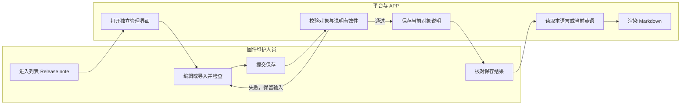

# 固件支持 Release note 及多语言配置

| 项目 | 内容 |
| --- | --- |
| 更新日期 | 2026-11-06 |
| 交互原型 | [GitHub Pages 原型](https://hawzz.github.io/root-interactivable-prototype/prototypes/firmware-release-note/) |
| 相关文档 | [V6 历史基线](https://github.com/HawZZ/root-interactivable-prototype/blob/main/prototypes/firmware-release-note/docs/consensus-v6.md)、[多语言导入说明](https://github.com/HawZZ/root-interactivable-prototype/blob/main/prototypes/firmware-release-note/docs/import-spec.md)、[补充验收规格](https://github.com/HawZZ/root-interactivable-prototype/blob/main/prototypes/firmware-release-note/docs/review-contract.md)、[UI 现状与边界](https://github.com/HawZZ/root-interactivable-prototype/blob/main/prototypes/firmware-release-note/docs/ui-baseline.md)、[测试用例附录](https://github.com/HawZZ/root-interactivable-prototype/blob/main/prototypes/firmware-release-note/docs/test-cases.md) |

## 1. 摘要

为 MCU、模组固件及虚拟版本提供独立 Release note：任意生命周期状态均可从列表编辑 16 语言说明，支持导入、预览，并将已保存内容供 APP 读取。

## 2. 需求范围

| Feature | 本需求要做什么 | 用户可见结果 |
| --- | --- | --- |
| F01 创建与编辑 | 三类对象分别维护独立 Release note；六种生命周期状态均可从列表编辑、预览、导入和保存 | 说明互不拼接、替换或联动；状态变化不阻断，首次发布也不锁定 |
| F02 多语言配置与兜底 | 支持 16 种语言；英语默认、必填并兜底，其余非必填 | 缺译时读取当前对象的英语 |
| F03 多语言导入 | 通过 Excel/CSV 导入当前对象的多语言 Markdown；状态变化不使合法预检失效 | 预检后应用独立管理表单，保存说明后生效 |
| F04 存量初始化 | 为历史三类对象补充字段并初始化英语 `Bug fixed` | 覆盖各状态；其他语言未配置；重复初始化不覆盖维护内容 |
| F05 APP 调用与 Markdown | 平台编辑、预览；APP 按对象和语言读取已保存内容并渲染 | 发布后纠错可保存；未保存草稿不可读，实际刷新由技术实现决定 |
| F06 关联删除限制 | 沿用虚拟版本与固件的现有关联关系校验删除 | 有任一关联时阻止直接删除并保留原数据 |

入口位于 `产品详情 > 固件配置 > 固件版本 / 虚拟版本列表 > 操作 > Release note`，打开独立管理界面。原新建、编辑及详情信息抽屉保留既有用途，且不嵌入说明编辑器；独立界面中的对象上下文只读，Release note 的语言、源码编辑、预览、导入和保存按平台权限可用。对象创建成功自动初始化英语 `Bug fixed`，随后可从列表单独维护。备注、发布日志、包信息、组件及发布配置不能替代 Release note，也不会因说明保存而改变。

开发中、测试中、发布中、暂停发布、已停止、已发布六种状态均提供上述操作；对象状态用于展示和对象自身生命周期管理，不构成 Release note 的编辑门槛。APP 仅要求读取及 Markdown 验证能力，不扩展升级页面；页面形态和新增边界见[UI 基线](https://github.com/HawZZ/root-interactivable-prototype/blob/main/prototypes/firmware-release-note/docs/ui-baseline.md)。

## 3. 用户角色与 JTBD

| 场景 | 用户角色 | JTBD | 对应 Feature |
| --- | --- | --- | --- |
| S01 全生命周期维护 | 固件维护人员 | 当对象处于任一生命周期状态且需要补充或纠正说明时，我想直接维护对应语言，从而让各阶段文案保持准确 | F01、F02、F05 |
| S02 批量填写语言 | 固件维护人员 | 当多语言文案已准备好时，我想安全导入当前对象，从而减少录入并避免误覆盖 | F02、F03 |
| S03 读取版本说明 | APP 用户 | 当 APP 展示目标对象时，我想看到当前语言或英语兜底内容，从而正常理解更新 | F02、F05 |
| S04 管理存量与删除 | 固件维护人员 | 当处理历史对象或被引用固件时，我想获得默认说明并避免破坏关联，从而安全维护 | F04、F06 |

## 4. 用户旅程

维护人员可从任一状态对象的列表操作列进入独立 Release note 管理，编辑、预览或导入后单独保存。对象状态在编辑、预检、预览或保存期间变化，不关闭管理界面、不清空草稿、不使已通过预检失效，也不阻止说明保存。保存仅更新当前对象的 Release note；固件包、冻结状态、对象状态、发布配置、组件、备注及发布日志保留最新值，不被说明草稿覆盖。保存失败时保留未提交内容，修正后可重试；未保存草稿不提供给 APP，保存后的内容供 APP 接口后续读取。

## 5. 核心流程与规则

### 5.1 S01：全生命周期编辑

创建成功自动初始化英语默认说明。开发中、测试中、发布中、暂停发布、已停止、已发布均可从独立入口编辑、预览、导入并保存；首次发布不锁定，发布后的纠错继续走同一入口。

对象状态可能在编辑、预检、预览或保存期间发生切换。仅为对象状态变化时，不阻断 Release note 操作，不清空当前表单或草稿，不使已通过的预检失效，也无需重新预检；若用户继续修改表单内容、更换导入文件或修改文件内容，则按最新内容重新计算差异或预检。保存时校验当前表单的英语非空及技术冻结的长度和资源上限，不以对象状态作为拒绝条件。

保存仅更新当前对象的 Release note 说明字段，不改变固件包、虚拟版本冻结状态、组件集合、应用对象、发布方式、范围、进度、对象状态、备注或发布日志。保存失败保留输入；取消编辑不改变已保存记录。

### 5.2 S02：Excel/CSV 导入

流程：列表「Release note」 → 独立管理 → 选择文件 → **预检** → 差异确认 → **应用当前表单** → **保存 Release note**。本节的“当前表单”和“主保存”均指 Release note 独立管理表单及其保存操作。对象处于任一生命周期状态均可执行该流程；预检失败或无有效变更时禁止应用，已保存数据零改写。

导入只作用当前对象。Excel 使用 16 语言数据格全空的模板，CSV 使用 UTF-8；非空值覆盖当前表单对应语言，空值、纯空白或缺列保留现值，包括自定义英语和非英语译文。导入不承担清空语义；仅在表单手工清空非英语后才恢复英语兜底，合并后英语仍须非空。空文件、只有表头或无有效变更禁止应用。

预检后应用只写入当前表单，主保存才持久化。预检、应用或保存期间对象状态变化，不清空文件或表单、不使已通过的预检失效，也不阻止应用或保存；文件或当前表单内容变化时才需按最新内容重新计算差异。取消导入不改原表单；解析错误或超限整单拒绝；应用后取消编辑或保存失败均不部分更新已保存记录，失败时保留当前草稿。完整模板、格式、工作表/数据行、编码、重复列、公式及异常定位规则见[导入说明](https://github.com/HawZZ/root-interactivable-prototype/blob/main/prototypes/firmware-release-note/docs/import-spec.md)，L/L+1 和实施冻结项见[补充验收规格](https://github.com/HawZZ/root-interactivable-prototype/blob/main/prototypes/firmware-release-note/docs/review-contract.md)。

### 5.3 S03：语言兜底与 Markdown

三类对象分别维护 16 种语言。英语 `en` 默认精确为 `Bug fixed`，必填且兜底；其余 15 种为 `zh、de、fr、zh-Hant、it、pt、es、ar、vi、id、th、ms、ja、ru、fil`，非必填。目标语言有内容时读取自身，否则读取当前对象的当前英语；非英语手工清空后恢复兜底，英语修改后缺译内容随新英语读取。切换语言保留草稿，对象状态变化也不清空任何语言草稿；缺译展示不得伪装成独立译文。

平台提供 Markdown 源码编辑和只读预览，APP 读取已保存内容并渲染。标题、列表、强调、链接和换行为必需能力；表格、代码块和图片按技术冻结的共同能力支持或可读降级。保存与导入须保留源码、换行和转义；平台预览与 APP 使用同一源码和策略，按 MD01–MD10 核对语义、内容、结构及安全一致，允许视觉差异。原始 HTML/脚本不得执行，危险链接/图片协议不得运行；共同元素及 URL 策略在实施验收前由技术冻结，详见[补充验收规格](https://github.com/HawZZ/root-interactivable-prototype/blob/main/prototypes/firmware-release-note/docs/review-contract.md)。

### 5.4 S04：存量初始化与关联删除

Release note 为新增字段，无旧译文迁移。上线时为全部存量 MCU、模组和虚拟版本初始化英语 `Bug fixed`，覆盖各生命周期状态；其他语言未配置。初始化后所有状态均可人工编辑，重复初始化不得覆盖已维护内容。

存在任一现有虚拟版本关联时阻止直接删除固件，开发中也不能绕过；失败后固件、说明及全部关联保持原值，不自动解绑或级联删除。无关联时仍按既有生命周期判断。Release note 全生命周期可编辑不改变删除规则、关联校验或固件包冻结边界。

## 6. 功能详情

### 6.1 F01：对象范围与全生命周期访问

三类对象分别绑定自己的说明，均从列表操作列的 Release note 入口单独管理。独立界面仅展示对象只读上下文和说明配置；发布日志和内部备注保持原用途，不作为来源或默认值。对象创建成功自动初始化英语 `Bug fixed`，对象状态不限制说明操作。

| 状态 | 操作 | 结果与边界 |
| --- | --- | --- |
| 开发中 | 编辑、预览、导入、保存 | 保存只更新说明，不改变对象状态及其他配置 |
| 测试中 | 编辑、预览、导入、保存 | 状态切换或定时发布生效不关闭入口，也不阻断编辑 |
| 发布中 | 编辑、预览、导入、保存 | 达到 100% 或全面发布后仍可继续维护，不形成截止点 |
| 暂停发布 | 编辑、预览、导入、保存 | 暂停不移除说明操作，也不清空已保存内容或草稿 |
| 已停止 | 编辑、预览、导入、保存 | 停止不影响说明维护，历史说明保留且可纠正 |
| 已发布 | 编辑、预览、导入、保存 | 首次发布不锁定；纠错保存后供 APP 接口后续读取 |

各对象按自身 Release note 独立维护。六种状态不设 Release note 编辑门禁；状态在编辑、预检或保存期间切换时，输入、预检及保存能力均保持，保存仍只作用于说明字段。

### 6.2 F02：字段、16 语言与兜底

| 字段 | 来源 | 类型/格式 | 必填、默认与可编辑性 | 校验与读取 |
| --- | --- | --- | --- | --- |
| 对象上下文 | 当前对象记录 | 名称、版本、状态、包、冻结、发布配置等 | 只读；说明保存不修改 | 仅用于识别对象和展示现状 |
| 英语（`en`） | 用户编辑或导入 | Markdown | 默认 `Bug fixed`；必填；六态可编辑 | 空文本或纯空白不可保存；作为兜底 |
| 其他 15 种语言 | 用户编辑或导入 | Markdown | 默认未配置；非必填；六态可编辑 | 有内容读取自身，否则读取当前英语 |
| 语言选择 | Release note 16 语言 | 枚举 | 默认英语；可切换 | 切换保留草稿；状态变化不清空草稿 |
| Markdown 预览 | 当前表单源码 | 只读渲染 | 只读，不写回源码 | 与保存/APP 使用同一源码与策略 |
| 内部备注 | 对象记录 | 原字段 | 按原对象规则维护 | 不复制、不拼接、不参与初始化 |

英语变化影响兜底语言；已配置的其他语言各自保留，不自动翻译或联动清空。对象状态、固件包、冻结状态、发布配置、组件及备注属于只读上下文，不因 Release note 保存而更新。

### 6.3 F03–F06：导入、存量、读取与删除

| Feature | 功能规则 |
| --- | --- |
| F03 导入 | 入口位于独立 Release note 管理界面，六态均可使用，只作用当前对象；预检、表单、主保存及失败零写入按 §5.2。对象状态变化不使合法预检失效。 |
| F04 存量 | 历史三类对象在全部状态初始化英语 `Bug fixed`，其他语言未配置；初始化后可六态编辑，幂等边界按 §5.4。 |
| F05 APP 读取 | 平台编辑/预览，APP 读取已保存对象与语言并渲染；发布后纠错保存后可后续读取，未保存草稿不可读。接口、缓存和实际刷新时间由技术侧实现，不承诺固定时延。虚拟版本读取自身，原型验证面板不代表升级页或真实联调。 |
| F06 删除 | 有任一虚拟版本关联即阻止直接删除并保留全部原值；无关联按既有生命周期，规则见 §5.4。 |

## 7. 实施分工

| 事项 | 责任方与边界 | 验收前落实结果 |
| --- | --- | --- |
| APP 接口 | 技术侧确定端点、字段、参数、缓存及兼容实现 | 按对象和语言读取已保存内容；发布后纠错可后续读取；草稿不可读；不承诺固定刷新时延 |
| 平台统一权限 | 现有平台机制统一处理，不新增权限点或权限矩阵 | 既有授权不变；六态 Release note 操作不另设状态门禁 |
| 存储、初始化与关联校验 | 技术侧落实字段、存量初始化、幂等及关联删除判断 | 数据隔离；初始化不覆盖；关联删除零变更；说明保存不更新对象业务字段 |
| Excel/CSV 与 Markdown | 技术侧落实解析、预检、编辑预览、APP 渲染和安全处理 | 导入失败无部分写入；状态变化保持预检与输入；源码保留；按 MD01–MD10 验收 |
| 实施冻结 | 技术/QA 在开发验收前确定文件大小、单语言长度 L、资源上限、共同元素及 URL 策略 | 上限与策略可追溯，以 L/L+1 验证且不能静默截断 |

接口契约、平台权限和实施冻结由技术侧负责。

## 8. 验收索引

| ID | Feature/场景 | 验收主题 | 结果要求 | 原型页面/规格 |
| --- | --- | --- | --- | --- |
| AC01 | F01/S01 | 创建默认值 | 三类对象创建成功自动默认精确为 `Bug fixed`，从列表独立入口查看 | [#create](https://hawzz.github.io/root-interactivable-prototype/prototypes/firmware-release-note/#create)、§6.2 |
| AC02 | F01/S01 | 全生命周期编辑 | 三类对象在开发中、测试中、发布中、暂停发布、已停止、已发布六态均可从独立界面编辑、预览、导入并保存；首次发布不锁定 | [#release-note](https://hawzz.github.io/root-interactivable-prototype/prototypes/firmware-release-note/#release-note)、§6.1 |
| AC03 | F01/S01 | 状态变化连续性 | 编辑、预检或保存期间对象状态变化，不阻断操作、不清空输入、不使合法预检失效；保存仍只更新说明 | [#release-note](https://hawzz.github.io/root-interactivable-prototype/prototypes/firmware-release-note/#release-note)、§5.1、§5.2 |
| AC04 | F02/S03 | 英语兜底 | 共 16 语言；英语必填，其他非必填，缺译读取当前英语 | [#release-note](https://hawzz.github.io/root-interactivable-prototype/prototypes/firmware-release-note/#release-note)、§6.2 |
| AC05 | F03/S02 | Excel/CSV 导入 | 非空值增量合并；预检、应用及主保存分步；失败不部分写入 | [#import](https://hawzz.github.io/root-interactivable-prototype/prototypes/firmware-release-note/#import)、§5.2 |
| AC06 | F04/S04 | 存量默认值 | 三类对象各状态初始化英语 `Bug fixed`，其他语言未配置，重复初始化不覆盖；初始化后可继续编辑 | [#history](https://hawzz.github.io/root-interactivable-prototype/prototypes/firmware-release-note/#history)、§5.4 |
| AC07 | F01–F04 | 对象隔离 | 说明由列表独立入口维护；信息抽屉无说明编辑器；保存说明仅改当前对象说明，信息保存保留说明 | [#firmware](https://hawzz.github.io/root-interactivable-prototype/prototypes/firmware-release-note/#firmware)、[#virtual](https://hawzz.github.io/root-interactivable-prototype/prototypes/firmware-release-note/#virtual) |
| AC08 | F03/S02 | 取消与异常 | 取消不误改；错误整单阻断；保存失败保留输入且零部分写入 | [#import](https://hawzz.github.io/root-interactivable-prototype/prototypes/firmware-release-note/#import)、§5.2 |
| AC09 | F01、F05 | 虚拟版本独立 | 独立配置，读取自身说明，不拼接组件 | [#virtual](https://hawzz.github.io/root-interactivable-prototype/prototypes/firmware-release-note/#virtual)、[#consumer](https://hawzz.github.io/root-interactivable-prototype/prototypes/firmware-release-note/#consumer) |
| AC10 | F05/S03 | 发布后纠错与读取 | 已发布对象仍可编辑并保存纠错；APP 后续接口只读取已保存内容，未保存草稿不可读，不承诺固定刷新时延 | [#release-note](https://hawzz.github.io/root-interactivable-prototype/prototypes/firmware-release-note/#release-note)、[#consumer](https://hawzz.github.io/root-interactivable-prototype/prototypes/firmware-release-note/#consumer)、§6.3、§7 |
| AC11 | F05 | Markdown | 平台配置及导入保留源码；平台预览与 APP 按共同策略渲染 | [#release-note](https://hawzz.github.io/root-interactivable-prototype/prototypes/firmware-release-note/#release-note)、[#consumer](https://hawzz.github.io/root-interactivable-prototype/prototypes/firmware-release-note/#consumer)、§5.3 |
| AC12 | F06/S04 | 关联删除限制 | 有任一关联的固件不可直接删除；无关联按原生命周期 | [#firmware](https://hawzz.github.io/root-interactivable-prototype/prototypes/firmware-release-note/#firmware)、§5.4 |
| AC13 | F05/S03 | APP 调用 | 已保存说明可按对象及语言读取；接口与缓存实现由技术确定 | [#consumer](https://hawzz.github.io/root-interactivable-prototype/prototypes/firmware-release-note/#consumer)、§5.3、§7 |

## 9. 测试引用

完整 28 条用例见[测试用例附录](https://github.com/HawZZ/root-interactivable-prototype/blob/main/prototypes/firmware-release-note/docs/test-cases.md)；异常导入及 MD01–MD10 按[补充验收规格](https://github.com/HawZZ/root-interactivable-prototype/blob/main/prototypes/firmware-release-note/docs/review-contract.md)执行，QA 须记录样本、策略版本、对象与语言。本文和附录均为待实施验证规格，不表示真实平台、APP、初始化或生产联调已经通过。
